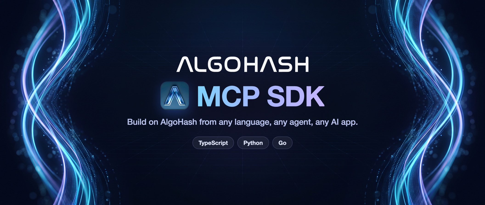
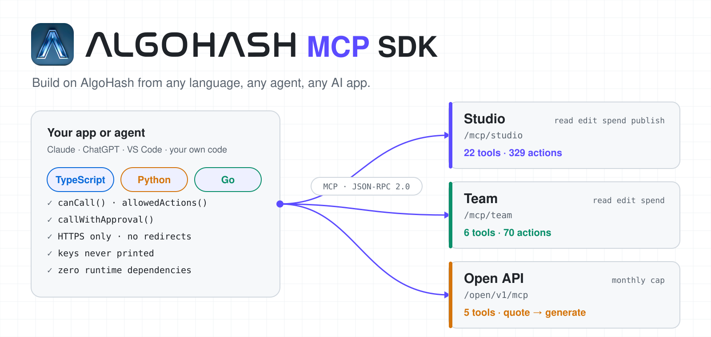

<p align="center">
  <a href="https://console.algohash.ai"></a>
</p>

<p align="center">
  <a href="README.md">🇺🇸 English</a> |
  <a href="README.zh-TW.md">🇹🇼 繁體中文</a> |
  <a href="README.zh-CN.md">🇨🇳 简体中文</a> |
  <a href="README.ja.md">🇯🇵 日本語</a> |
  <a href="README.ko.md">🇰🇷 한국어</a> |
  <a href="README.es.md">🇪🇸 Español</a> |
  <a href="README.vi.md">🇻🇳 Tiếng Việt</a> |
  <a href="README.id.md">🇮🇩 Bahasa Indonesia</a>
</p>

<p align="center">
  
  
  
  
  <a href="LICENSE"></a>
</p>

<p align="center">
  
  
  
  
</p>

<p align="center">
  <b>Bangun di atas AlgoHash dari bahasa apa pun, agen apa pun, dan aplikasi AI apa pun.</b>
</p>

<p align="center">
  SDK open source resmi untuk server <a href="https://modelcontextprotocol.io">Model Context Protocol</a> milik AlgoHash.<br>
  Hasilkan gambar dan video, jalankan storyboard, kelola tim AI Anda, dan panggil Open API,<br>
  dengan klien bertipe untuk <b>TypeScript</b>, <b>Python</b>, dan <b>Go</b>, semuanya dihasilkan dari satu spesifikasi terbuka.
</p>

<p align="center">
  <a href="https://console.algohash.ai">
    <picture>
      <source media="(prefers-color-scheme: dark)" srcset="assets/hero-dark.svg">
      
    </picture>
  </a>
</p>

<p align="center">
  <a href="#-mulai-cepat"><b>Mulai Cepat</b></a> ·
  <a href="docs/overview.md"><b>Dokumentasi</b></a> ·
  <a href="docs/reference/"><b>Referensi Tool</b></a> ·
  <a href="samples/"><b>Contoh</b></a> ·
  <a href="docs/security.md"><b>Keamanan</b></a> ·
  <a href="CHANGELOG.md"><b>Catatan Perubahan</b></a>
</p>

---

## ✨ Mengapa AlgoHash MCP SDK

- **🔗 Satu SDK, tiga server** - Studio, Team, dan Open API memakai satu bentuk klien, satu tipe hasil, dan satu model error yang sama
- **🛡️ Aman secara default** - langkah berbayar dan langkah publik di Studio dan Team menunggu persetujuan Anda di AlgoHash; agen Anda tidak bisa menyetujui pengeluarannya sendiri
- **🧬 Bertipe dan dihasilkan otomatis** - 399 action, masing-masing dibungkus dan didokumentasikan langsung dari spesifikasi terbuka, sehingga SDK tidak pernah menyimpang dari server
- **🪶 Nol dependensi** - hanya `fetch`, `urllib`, dan `net/http` bawaan platform; tidak ada tambahan yang perlu diaudit, dikunci versinya, atau ditambal
- **🧪 Coba tanpa kunci** - server mock lokal menjalankan semua contoh dan pengujian tanpa akun dan tanpa biaya

## 🚀 Mulai Cepat

### 1. Instal

```bash
npm install @algohash/mcp                                  # TypeScript / JavaScript
pip install algohash-mcp                                   # Python
go get github.com/Algohash-inc/algohash-mcp-sdk/sdks/go      # Go
```

### 2. Dapatkan kunci

Buat kunci di **Studio → MCP → Keys** (atau **Team → MCP → Keys & scopes**, atau halaman kunci Open API),
lalu simpan di variabel lingkungan. Jangan pernah menuliskannya langsung di kode.

```bash
export ALGOHASH_STUDIO_KEY="smk_..."
```

### 3. Lakukan panggilan pertama Anda

```ts
import { StudioClient } from "@algohash/mcp";

const studio = new StudioClient({ apiKey: process.env.ALGOHASH_STUDIO_KEY!, keyScopes: ["read", "edit"] });
const assets = await studio.core.listAssets({ pillar: "avatars" });
console.log(assets.status, assets.data);
```

Belum punya kunci? Jalankan `node tools/mock-server.mjs` dan setel `ALGOHASH_MOCK=1`. Semua contoh bisa berjalan secara offline.

## 🧩 Apa yang Bisa Anda Bangun

| Server | Endpoint | Bangun Hal Seperti | Kunci |
|----------|----------|----------|----------|
| **🎬 Studio** | `https://console.algohash.ai/mcp/studio` | Agen yang mengubah brief menjadi storyboard lalu video jadi · penjelajah pustaka · penerbit media sosial terjadwal | `smk_…` atau OAuth |
| **🤝 Team** | `https://console.algohash.ai/mcp/team` | Pembangun tim yang menyusun rekan tim dari sebuah brief · bot deploy yang memberi tugas ke grup · siklus evolusi | `tmk_…` atau OAuth |
| **⚡ Open API** | `https://console.algohash.ai/open/v1/mcp` | Widget harga · generator massal dengan penawaran harga · pemantau saldo | Kunci Open API |

Setiap kunci terikat pada **satu akun: akun Anda**. Tidak ada argumen yang bisa menjangkau akun lain, dan server
menegakkan hal itu apa pun yang dilakukan klien.

## 🔍 Lihat Apa yang Bisa Dilakukan Sebuah Kunci

Setiap action dalam spesifikasi mendeklarasikan scope yang dibutuhkannya. Pindai kunci sebelum Anda menyerahkannya ke agen:

```
+------------------------------------------------------------------------------+
|  KEY: Studio, scopes [read, edit]           271 allowed  ·  58 denied        |
+------------------------------------------------------------------------------+
|                                                                              |
|  ALLOWED (sample)                                                            |
|     studio.list_assets ............ read      browse your library            |
|     studio_create.storyboard ...... edit      plan a storyboard (free)       |
|     studio_storyboard.approve ..... edit      approve a drawn storyboard     |
|                                                                              |
|  DENIED: needs spend                                                         |
|     studio.generate_image ......... spend     paid image generation          |
|     studio_create.storyboard_draw . spend     draw storyboard frames         |
|                                                                              |
|  DENIED: needs publish                                                       |
|     studio.ig_publish_now ......... publish   posts publicly                 |
|                                                                              |
|  NOTE                                                                        |
|     motion_create, motion_direct_reply: free with some arguments, paid       |
|     with others. The paid path is refused without `spend`.                   |
|                                                                              |
+------------------------------------------------------------------------------+
```

```bash
node tools/permissions.mjs studio read,edit            # this table, per tool
node tools/permissions.mjs studio read,edit --denied   # only what the key cannot do
```

Pemeriksaan yang sama sudah terpasang di setiap klien: `canCall`, `allowedActions`, dan `requiredScopes` menolak
panggilan di luar scope sebelum panggilan itu meninggalkan mesin Anda.

## 💳 Cara Kerja Panggilan Berbayar

```
┌─────────────────────────────────────────────────────────────────┐
│  1. CALL                                                        │
│     studio.generate_image { prompt, ratio }                     │
└─────────────────────────────────────────────────────────────────┘
                              │
                              ▼
┌─────────────────────────────────────────────────────────────────┐
│  2. LOCAL PREFLIGHT (SDK)                                       │
│     • Key has `spend`?  No → scope_denied, nothing is sent      │
│     • HTTPS endpoint, no redirect, key in header only           │
└─────────────────────────────────────────────────────────────────┘
                              │
                              ▼
┌─────────────────────────────────────────────────────────────────┐
│  3. SERVER QUOTES: needs_confirmation (not an error)            │
│     • fee_hwt + summary + single-use confirm_token              │
│     • MCP Apps hosts show a card: Approve / Decline             │
└─────────────────────────────────────────────────────────────────┘
                              │
                              ▼
┌─────────────────────────────────────────────────────────────────┐
│  4. THE USER APPROVES                                           │
│     • one tap on Approve, or a yes in chat. Nothing charged yet │
│     • page-approval keys: only the owner, on approve_url        │
└─────────────────────────────────────────────────────────────────┘
                              │
                              ▼
┌─────────────────────────────────────────────────────────────────┐
│  5. SAME CALL + confirm_token → job starts, cost charged once   │
└─────────────────────────────────────────────────────────────────┘
```

Langkah publik (memposting, menerbitkan) mengikuti alur yang sama dengan `needs_permission` dan
`permission_token`. Langkah yang bersifat destruktif ditolak dengan `confirm_required` kecuali Anda menyertakan `confirm: true`.

## 🧭 Studio vs. Team vs. Open API

### 🟣 Studio

- Akun Studio Anda: pustaka, gambar, video, storyboard, editor, hasil keluaran, postingan media sosial
- Scope `read`, `edit`, `spend`, `publish`; kunci baru secara default memakai `read` + `edit` + `spend`
- Storyboard lebih dulu: setiap video dimulai dari storyboard yang sudah Anda setujui
- 22 tool · 329 action

### 🟢 Team

- Tim AI Anda: rekan tim, grup, blueprint, skill, deploy, evolusi
- Scope `read`, `edit`, `spend`; kunci baru secara default memakai `read` + `edit`
- Selalu bertanya sebelum membelanjakan, menghapus, menerapkan draf, atau membuka tool berisiko
- `client_ref` membuat panggilan pembuatan aman untuk dicoba ulang; draf membawa `rev`
- 6 tool · 70 action

### 🟠 Open API

- Katalog model, penawaran harga, pengiriman job, saldo
- Tanpa scope; ada batas bulanan pada kunci
- Minta penawaran dulu, lalu generate, kemudian poll `job_status`
- 5 tool

## 📦 Fitur

- **Wrapper yang dihasilkan otomatis** - satu metode per action di ketiga bahasa, lengkap dengan scope dan flag di komentar dokumentasi
- **Preflight scope lokal** - panggilan di luar scope langsung gagal dengan `scope_denied` dan tidak pernah menyentuh jaringan
- **Helper persetujuan** - `callWithApproval` meneruskan setiap penawaran harga dan permintaan izin ke penyetuju Anda dan tidak pernah menyetujui sendiri
- **Transport yang diperkuat** - hanya HTTPS (kecuali `localhost`), tanpa redirect, batas ukuran respons, kunci tidak pernah dicetak atau diserialisasi
- **Batching dan percobaan ulang** - hingga 20 panggilan per batch; `rate_limited` dicoba ulang sesuai `retry_after_sec` dari server, dibatasi maksimal 30 detik
- **Hasil bertipe** - satu `ToolResult` untuk data, persetujuan, dan error, ditambah petunjuk `next` dari server
- **Server mock dan pemindai** - mock offline, pemindai izin, generator kode, dan pemindai kebocoran di `tools/`
- **Referensi yang dihasilkan otomatis** - setiap tool, action, scope, dan flag ada di [docs/reference](docs/reference/)

## 🔌 Hubungkan Aplikasi AI

Tidak perlu kode. Arahkan aplikasi ke URL server lalu masuk.

| Host | Cara |
|----------|----------|
| **Claude** (web, desktop, mobile) | Settings → Connectors → Add custom connector → tempel URL → masuk |
| **ChatGPT** | Settings → Apps & Connectors → Developer mode → Create → URL + OAuth |
| **VS Code** | [`samples/hosts/vscode/mcp.json`](samples/hosts/vscode/mcp.json) (kunci diminta saat dipakai, tidak pernah disimpan di file) |
| **Claude Code** | [`samples/hosts/claude-code/.mcp.json`](samples/hosts/claude-code/.mcp.json) (kunci dari `${ALGOHASH_STUDIO_KEY}`) |
| **OpenAI Codex** | [`samples/hosts/codex/config.toml`](samples/hosts/codex/config.toml) (`bearer_token_env_var`) |

Panduan langkah demi langkah untuk setiap host: [docs/hosts.md](docs/hosts.md).

## 💻 Penggunaan SDK

### TypeScript

```ts
import { StudioClient } from "@algohash/mcp";

const studio = new StudioClient({ apiKey: process.env.ALGOHASH_STUDIO_KEY!, keyScopes: ["read", "edit", "spend"] });

// Free read.
const assets = await studio.core.listAssets({ pillar: "avatars" });

// Paid step: the server answers needs_confirmation with a price and a single-use token.
// callWithApproval hands it to YOUR approver; it never approves on its own.
const r = await studio.callWithApproval(
  "studio_create",
  { action: "storyboard_draw", version: "v_123" },
  { approve: async (q) => askHuman(`Spend ${q.feeHwt} HWT on ${q.tool}.${q.action}? ${q.approveUrl ?? ""}`) },
);
console.log(r.status, r.data);   // "ok" | "declined" | "awaiting_approval" | "error" | …
```

### Python

```python
import os
from algohash_mcp import StudioClient

studio = StudioClient(os.environ["ALGOHASH_STUDIO_KEY"], key_scopes=["read", "edit", "spend"])
r = studio.call_with_approval("studio_create", {"action": "storyboard_draw", "version": "v_123"},
                              approve=lambda q: ask_human(f"Spend {q.fee_hwt} HWT? {q.approve_url or ''}"))
```

### Go

```go
s := algohash.NewStudio(os.Getenv("ALGOHASH_STUDIO_KEY"), algohash.WithKeyScopes("read", "edit", "spend"))
r, err := s.CallWithApproval(ctx, "studio_create", algohash.Params{"action": "storyboard_draw", "version": "v_123"}, askHuman)
```

### Contoh Prompt

Setelah server terhubung ke aplikasi AI Anda, cukup minta:

```
Tampilkan karakter-karakter di pustaka Studio saya.
Rencanakan storyboard 20 detik untuk merek kopi, lalu tunjukkan penawaran harganya sebelum digambar.
Bangun tim riset beranggotakan tiga orang dari brief ini dan biarkan saya meninjau drafnya lebih dulu.
Berapa biaya satu gambar 1K di Open API?
```

### Contoh

```bash
node tools/mock-server.mjs                                    # terminal 1: 127.0.0.1:8787
```

```bash
ALGOHASH_MOCK=1 node samples/typescript/03-generate-image.mjs # terminal 2
```

| Contoh | TypeScript | Python | Go |
|----------|----------|----------|----------|
| **Apa yang bisa dilakukan kunci ini?** | `01-permissions.mjs` | `01_permissions.py` | `cmd/permissions` |
| **Jelajahi pustaka** | `02-library.mjs` | `02_library.py` | |
| **Buat gambar (berbayar)** | `03-generate-image.mjs` | `03_generate_image.py` | `cmd/generate-image` |
| **Storyboard, lalu video** | `04-storyboard-video.mjs` | `04_storyboard_video.py` | |
| **Team: deploy pekerjaan** | `05-team-deploy.mjs` | `05_team_deploy.py` | `cmd/team-deploy` |
| **Open API: penawaran → generate** | `06-open-quote.mjs` | `06_open_quote.py` | `cmd/open-quote` |
| **Tool untuk agen Anda sendiri** | `07-agent-context.mjs` | | |

Contoh-contoh ini akan bertanya kepada Anda di terminal sebelum langkah berbayar atau publik apa pun. Tanpa terminal, semuanya ditolak.

## 📚 Dokumentasi

| Topik | Yang Akan Anda Pelajari |
|----------|----------|
| [Overview](docs/overview.md) | Server, tool dan action, HWT, hasil, petunjuk `next` |
| [Authentication](docs/authentication.md) | Kunci statis, OAuth 2.1, rotasi, penyimpanan |
| [Permissions](docs/permissions.md) | Scope, hak akses minimum, memindai kunci · [matriks lengkap](docs/reference/permissions.md) |
| [Approvals](docs/approvals.md) | `needs_confirmation`, `needs_permission`, `needs_storyboard`, `needs_cast` |
| [Protocol](docs/protocol.md) | Transport, versi, batching, bentuk hasil |
| [Errors and limits](docs/errors.md) | Semua kode error, mana yang dicoba ulang dan mana yang tidak boleh sama sekali |
| [Security](docs/security.md) | Model ancaman untuk integrator: kunci, prompt injection, kontrol pengeluaran |
| [Connecting MCP hosts](docs/hosts.md) | Claude, ChatGPT, VS Code, Claude Code, Codex, klien apa pun |
| **Panduan** | [Studio](docs/guides/studio.md) · [Team](docs/guides/team.md) · [Open API](docs/guides/open.md) |
| **SDK** | [TypeScript](docs/sdk-typescript.md) · [Python](docs/sdk-python.md) · [Go](docs/sdk-go.md) |
| **Referensi** | [Studio](docs/reference/studio.md) · [Team](docs/reference/team.md) · [Open API](docs/reference/open.md) (dihasilkan otomatis) |

## 🔐 Keamanan

**Tidak ada yang ditagih sebelum Anda menyetujui.** Langkah berbayar atau publik pertama-tama mengembalikan penawaran harga; satu ketukan pada **Setujui**
di kartu langsung menjalankannya (host tanpa kartu: jawab «ya» di chat). Untuk kunci yang perlu lebih ketat, aktifkan
**Hanya saya yang bisa menyetujui langkah berbayar dan berisiko**: langkah tersebut lalu mengembalikan `approve_url`, hanya Anda yang bisa menyetujuinya
di AlgoHash saat sudah masuk, dan «ya» yang diketik di chat tidak dihitung.

- **Hak akses minimum** - berikan setiap integrasi scope sesedikit mungkin yang dibutuhkannya. `spend` dan `publish` adalah izin terpisah, dan `spend` tidak berarti `edit`
- **Batas keras** - scope, batas harian (kunci MCP) atau batas bulanan (kunci Open API), dan pencabutan tetap berlaku meskipun agen terkena prompt injection
- **Kunci tetap rahasia** - hanya dikirim di header `Authorization` melalui HTTPS, tidak pernah dicetak, tidak pernah diikutkan melewati redirect

> Dengan persetujuan satu ketukan, agen yang terkena prompt injection bisa menyetujui langkah sendiri. Aktifkan **Hanya saya yang bisa menyetujui langkah berbayar dan berisiko** untuk setiap kunci yang agennya membaca konten yang tidak Anda kendalikan.
> Tanpa itu, persetujuan hanya mencegah kekeliruan, bukan agen yang telah disusupi. Baca [docs/security.md](docs/security.md) terlebih dahulu.

Menemukan kerentanan? Laporkan secara privat, sebagaimana dijelaskan di [SECURITY.md](SECURITY.md).

## 🤝 Berkontribusi

Kontribusi sangat diterima. Repositori ini **hanya berisi antarmuka**: tool, argumen, scope, protokol
persetujuan, dan kode error. Repositori ini tidak memuat kode server, dan server adalah otoritas untuk segalanya.

```
spec/                 The interface: studio.json, team.json, open.json (+ i18n summaries)
sdks/typescript/      @algohash/mcp
sdks/python/          algohash-mcp
sdks/go/              github.com/Algohash-inc/algohash-mcp-sdk/sdks/go
docs/                 Guides + generated reference
samples/              TypeScript, Python, Go samples + MCP host configs
tools/                codegen · mock-server · permissions · leak-scan · readme-check
```

```bash
# 1. The spec is the source of truth. Regenerate wrappers and reference:
node tools/codegen.mjs

# 2. Check generated files, scan for leaks, keep translations in step
node tools/codegen.mjs --check
node tools/leak-scan.mjs
node tools/readme-check.mjs

# 3. Test all three SDKs
(cd sdks/typescript && npm ci --ignore-scripts && npm test)
(cd sdks/python && python3 -m unittest discover -s tests)
(cd sdks/go && go vet ./... && go test -race ./...)
```

Baca [CONTRIBUTING.md](CONTRIBUTING.md) sebelum membuka pull request. CI menjalankan langkah yang sama dan setiap
contoh terhadap server mock.

## 🛠 Pemecahan Masalah

### `scope_denied`

Kunci tidak memiliki scope yang dibutuhkan action. Periksa dengan `node tools/permissions.mjs studio <scope Anda>`,
lalu tambahkan scope di Studio → MCP → Keys (atau Team → MCP → Keys & scopes). Jangan coba ulang tanpa perubahan.

### `needs_confirmation` / `needs_permission`

Bukan error. Tampilkan harga dan ringkasan kepada pengguna (host yang mendukung kartu akan menampilkan kartunya). Setelah mereka menyetujui
(satu ketukan, atau «ya» di chat; untuk kunci dengan persetujuan halaman, di halaman `approve_url`), ulangi
**panggilan yang persis sama** beserta token. Token hanya berlaku sekali, terikat pada argumen, dan kedaluwarsa setelah sekitar
5 menit. Mengubah argumen? Minta persetujuan lagi.

### `awaiting_approval`

Khusus kunci dengan persetujuan halaman: Anda mencoba ulang sebelum pemilik menyetujui di AlgoHash. Tidak ada yang berjalan dan tidak ada yang ditagih. Tunggu dengan
`studio_confirm.wait` (atau `team_confirm.wait`), lalu coba ulang dengan token yang sama.

### `insecure_endpoint` / `bad_endpoint`

SDK menolak `http://` (kecuali `localhost`) dan URL yang mengandung kredensial. Gunakan endpoint
`https://`. Jangan pernah mengambil endpoint dari input yang tidak tepercaya.

### `rate_limited`

Tunggu `retry_after_sec` detik. SDK mencoba ulang hal ini secara otomatis, dibatasi maksimal 30 detik.

### `stale_rev` (Team)

Seseorang mengubah draf. Panggil `team_blueprint.get` untuk mendapatkan `rev` terbaru, lalu coba ulang dengan nilai itu.

### Kunci bocor

Cabut sekarang juga di aplikasi. Kunci berhenti berfungsi pada permintaan berikutnya. Setelah itu periksa aktivitas akun Anda.

## 💬 Komunitas & Dukungan

- **Pertanyaan dan bug** - buka issue di repositori ini
- **Laporan keamanan** - jangan pernah di tempat publik; ikuti [SECURITY.md](SECURITY.md)
- **Apa yang berubah** - [CHANGELOG.md](CHANGELOG.md)
- **Bekerja dengan** - Claude (web, desktop, mobile) · ChatGPT · VS Code (GitHub Copilot Chat) · Claude Code · OpenAI Codex · klien MCP mana pun yang mendukung Streamable HTTP

---

## 📄 Lisensi

Dirilis di bawah [Lisensi MIT](LICENSE). Hak cipta © 2026 AlgoHash Inc.

<p align="center">
  <a href="https://console.algohash.ai"></a><br>
  <sub>Dibuat oleh <a href="https://console.algohash.ai">AlgoHash</a> · Jika SDK ini membantu Anda, beri repositori ini ⭐</sub>
</p>
